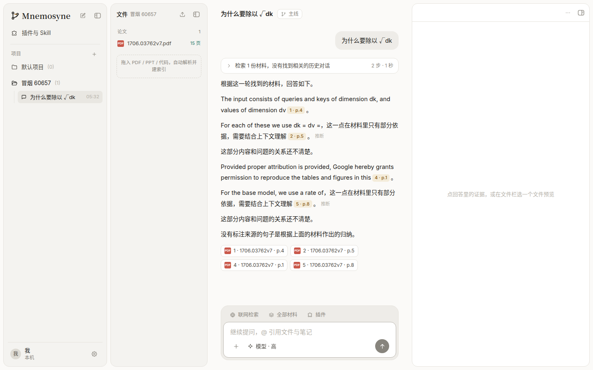
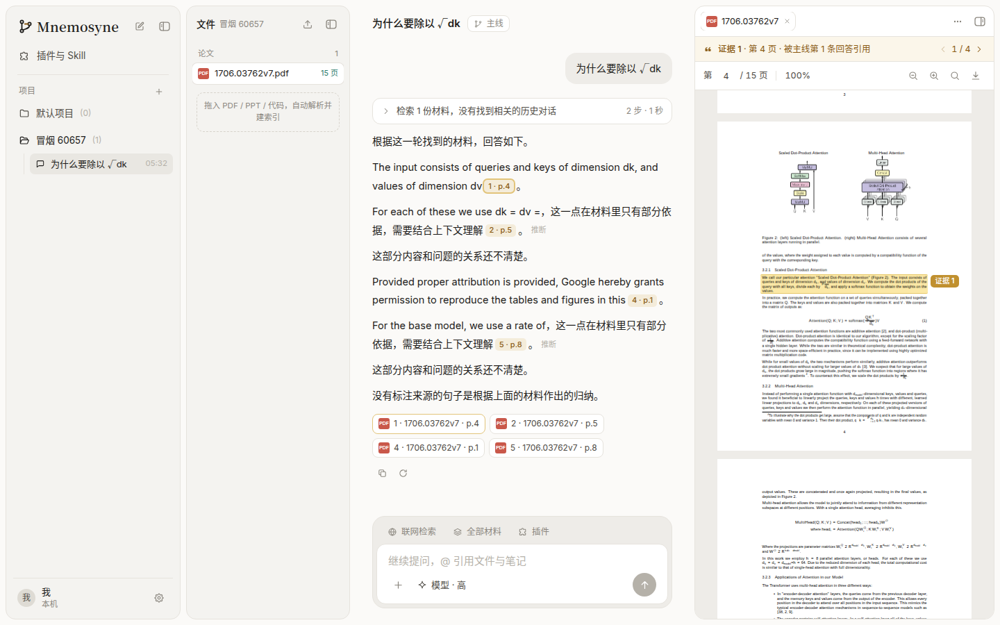
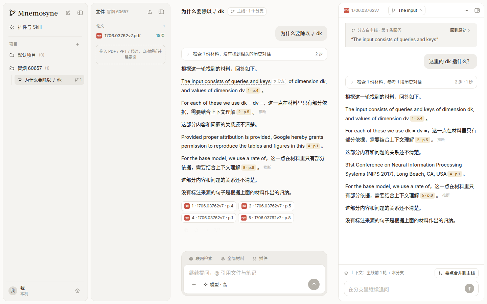
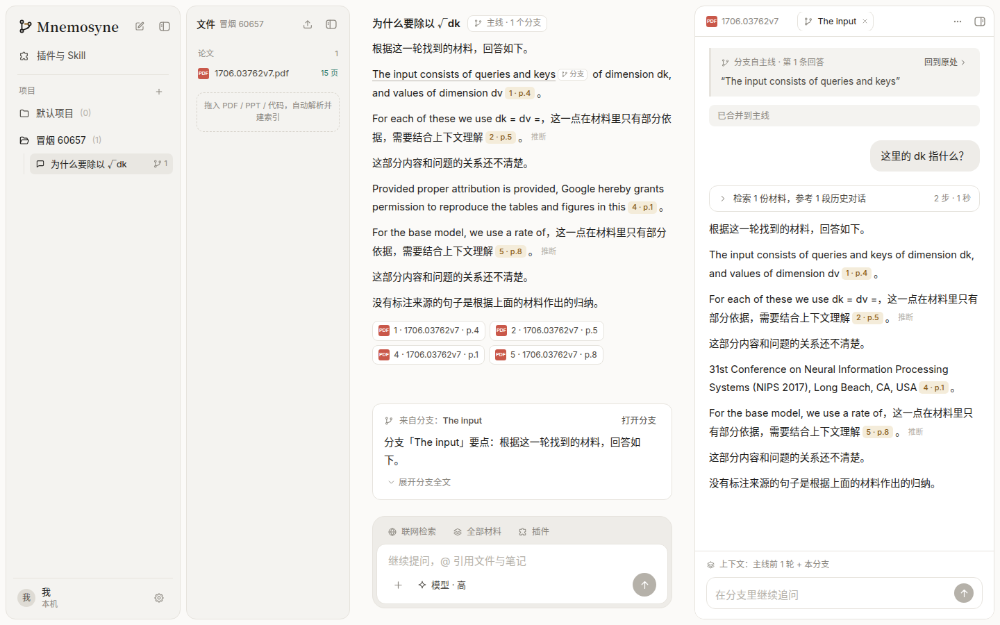
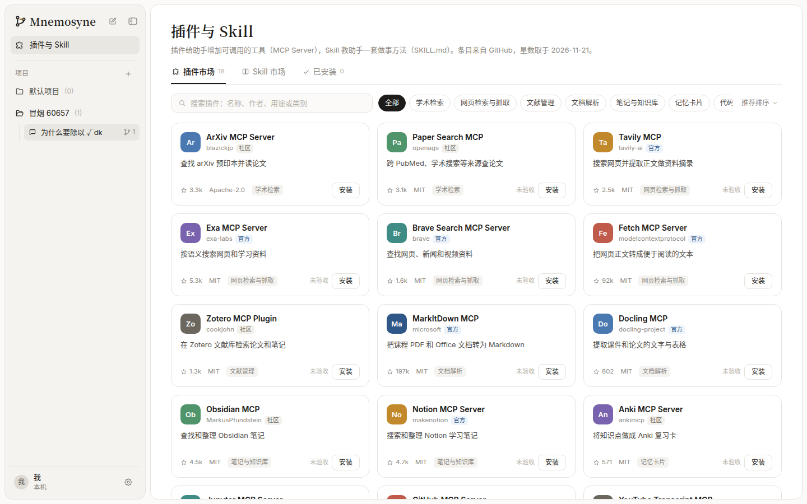
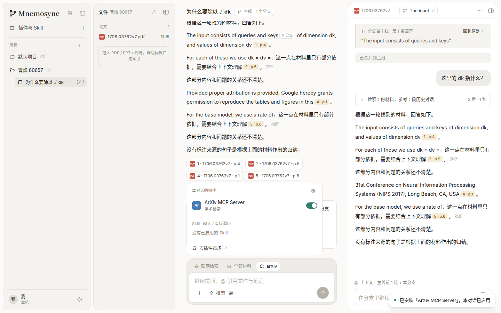
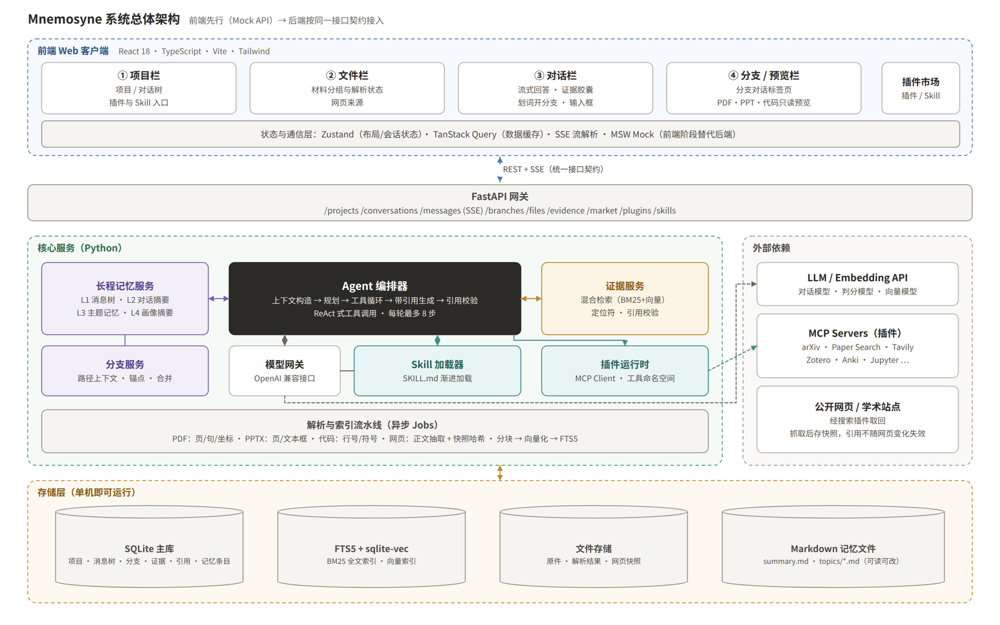

# Mnemosyne

**A learning assistant with long-term memory, evidence you can click back to, and conversations you can branch.**

Mnemosyne helps students work through papers, code and lecture slides. Answers point to the exact sentence, slide or line they rely on. Any sentence in an answer can be opened as a side branch for a follow-up question without derailing the main thread. Across sessions the assistant remembers what the student has studied and where they got stuck. Tools such as arXiv search or Zotero plug in through MCP servers, and reusable workflows are added as Skills.

This is the course project for INFO5000 (HKUST-GZ). Besides the app, the project produces a short paper that evaluates two things current memory benchmarks rarely measure: whether cited evidence actually lands on the right source, and whether information leaks between branches.

> **Status (2026-11-23): frontend and backend are implemented and run together locally; the evaluation has not been run.**
> By default the backend uses a **deterministic fake model** and a fake embedder, so it makes no paid calls and the answers are canned text built from retrieved passages, not real model output. A real chat model, a web-search provider and the LongMemEval dataset still have to be configured (see [Known limitations](#known-limitations)). The repository lives on a local machine; the code is not deployed anywhere.

[中文说明](./README.zh-CN.md) · [Developer & agent guide](./AGENTS.md) · [UX specs](./docs/ux/README.md) · [API contract](./docs/contract/README.md)

---

## What it does

| Feature | What the user sees |
|---|---|
| **Evidence tracing** | Uploaded PDFs, PPTX, code, notebooks and Markdown, plus web pages fetched during a turn, become *evidence units*. Each supported sentence in an answer carries a clickable chip; clicking it opens the right pane at the exact page, slide, line or web snapshot. Sentences without support are marked as inference. |
| **Branching conversations** | Select text in any answer → *Branch from here*. The branch opens in the right pane and only sees the path *root → anchor → branch*. Later main-thread turns and sibling branches stay out of its context. Key points can be merged back into the main thread. |
| **Long-term memory** | Four layers: the raw message tree (L1), per-conversation digests (L2), topic memories (L3) and a short learner profile (L4). Every memory item links back to the messages it came from. Memory runs in the background and is managed under *Settings → Memory*; the main UI does not emphasise it. |
| **Plugins & Skills** | A plugin market (MCP servers such as ArXiv, Fetch, Zotero, Anki, Jupyter) and a Skill market (`SKILL.md` folders such as Anthropic's `pdf`, `pptx`). Plugins can be switched on per conversation. |

## Interface

The workspace has four resizable, collapsible panes: projects, files, conversation, and a right pane that holds branches and read-only previews.

### Screenshots of the running app (fake model)

These are taken by the end-to-end smoke test against the real FastAPI backend (`web/tests/e2e-real/`), 1440×900. **The backend was running the deterministic fake model**, so the answer text is a template stitched from retrieved PDF sentences; the steps, evidence chips, PDF highlighting, branching and market flows are real. The paper is arXiv:1706.03762 (downloaded at test time, not shipped with the repo).

| | |
|---|---|
|  Answer with the step trail and evidence chips |  Clicking chip 1 opens page 4 of the PDF with the sentence highlighted |
|  A branch opened from a selected sentence, with a follow-up answer |  Key points merged back into the main thread; the branch becomes read-only |
|  Plugin market (entries are real GitHub projects) |  After installing a plugin, the composer lists it for this conversation |

The plugin installed in the last screenshot is a local fake MCP server registered under the ArXiv entry, so the test needs no network.

### Design mockups

The original design is in 11 HTML-rendered mockups in [`docs/assets/ui/`](docs/assets/ui/) (for example [workspace with a branch](docs/assets/ui/05-workspace-branch.png) and [home](docs/assets/ui/01-home.png)). Paper excerpts in the mockups are re-typeset for illustration. Where the running app differs from a mockup, the difference is recorded in [`docs/PROGRESS.md`](docs/PROGRESS.md).

## Architecture



Each turn runs this pipeline:

1. **Build context**: system prompt, L4 profile, messages on the current branch path, enabled plugin tools, and Skill names with descriptions.
2. **Tool loop** (ReAct, at most 8 steps): `search_materials`, `search_web`, `fetch_url`, `recall_memory`, `open_source`, `load_skill`, plus plugin tools. Every returned snippet is registered as candidate evidence `E1…Ek`.
3. **Generate with citations**: the model may only cite `[[E#]]` from this turn's pool.
4. **Verify citations**: each citation must exist in the pool, overlap lexically with the quoted sentence, and pass a small-model support check. Unsupported citations are removed and the sentence is marked as inference.
5. **Stream and persist** over SSE: steps, evidence and text deltas stream live; citation verdicts arrive after generation; `message.end` is sent once everything is stored.
6. **Background jobs**: memory extraction and consolidation, digest and profile rewrites, indexing of new files and web snapshots.

More diagrams: [turn pipeline](docs/assets/arch/f2-turn-pipeline.png) · [memory](docs/assets/arch/f3-memory.png) · [evidence](docs/assets/arch/f4-evidence.png) · [branching](docs/assets/arch/f5-branching.png) · [plugins & Skills](docs/assets/arch/f6-plugins-skills.png) · [data model](docs/assets/arch/f7-data-model.png) · [evaluation](docs/assets/arch/f8-evaluation.png) · [UX flow](docs/assets/arch/f9-ux-flow.png)

### Stack

| Layer | Choice |
|---|---|
| Frontend | React 18, TypeScript, Vite, Tailwind CSS, Zustand, TanStack Query, pdf.js, Shiki, react-markdown + KaTeX, framer-motion; panes use a hand-written pointer-drag layout. MSW mocks the backend for frontend tests |
| Backend | Python 3.11, FastAPI with SSE, SQLite (WAL) with FTS5 and sqlite-vec, PyMuPDF, python-pptx (+ LibreOffice for slide previews), trafilatura, the official `mcp` Python SDK |
| Retrieval | BM25 and vector top-50 each, fused with RRF (k = 60), top-8 into the evidence pool |
| Models | Any OpenAI-compatible endpoint; the chat model and the small model (memory extraction, citation checks) are configured separately. Default: deterministic fake model and fake hash embedder (no network) |

### Layout

```text
web/        React frontend (four-pane workspace, markets, previews)
server/     FastAPI backend (agent loop, memory, evidence, branches, plugins, jobs)
  scripts/  ingestion, registry build, LongMemEval prep, BranchMem generation, eval, judging, metrics
docs/
  contract/ REST, SSE, data model, locators, plugin manifest — single source of truth
  ux/       one spec per window, module and button, written for coding agents
  prompts/  ready-to-use task prompts for each milestone
  assets/   mockups and architecture diagrams
```

## Evaluation

| | |
|---|---|
| **Data** | LongMemEval_S (cleaned, 500 questions, ~115k-token histories with session- and turn-level evidence labels); a stratified dev split of 120 questions for tuning; **BranchMem**, our 120–150 item set built from LongMemEval with the correct evidence on the ancestor path and conflicting values in sibling branches |
| **Systems** | B1 full context · B2 naive RAG · M Mnemosyne · A1–A4 ablations (no source look-up, no evidence anchoring, no branch scoping, no L4 profile) |
| **Metrics** | QA accuracy (official GPT-4o judge), evidence Recall@k (session/turn), cited-turn hit rate plus a manual check of 100 answer–quote pairs, abstention accuracy, BranchMem branch accuracy and cross-branch leak rate, tokens and latency per question |

Hypotheses: evidence anchoring mainly helps knowledge-update and abstention questions (H1); cited-turn hit rate beats naive RAG (H2); branch scoping brings leakage close to zero without hurting main-thread accuracy (H3). Results will be reported whether or not they support these. We do not aim for a leaderboard total; vendor-reported scores are cited as background only.

## Running locally

Tested on Linux with Python 3.11 (managed by [uv](https://docs.astral.sh/uv/)) and Node.js 24. Nothing below makes a paid call unless you set the real-model variables yourself.

### Backend

```bash
cd server
uv sync                                    # create .venv and install dependencies
uv run python scripts/fetch_test_data.py   # optional: download the sample paper (arXiv 1706.03762v7) used by tests
uv run uvicorn app.main:app --port 8100    # fake model + fake embedder by default; data in server/data/
```

### Frontend

```bash
cd web
npm ci
npm run dev                                          # MSW mode: all /api calls answered by mocks in src/mocks/, no backend needed
MN_BACKEND=http://localhost:8100 npm run dev         # real-backend mode: MSW off, /api proxied to the backend
```

Open <http://localhost:5170>. `bash web/scripts/fetch-samples.sh` downloads the sample PDF that the MSW previews use.

### Tests

```bash
cd server && uv run pytest -q                        # backend unit, API and contract tests (fake model, no network)
cd web && npm run check                              # typecheck, lint, prettier, fixture schema check
cd web && npm test                                   # Vitest unit tests
cd web && npx playwright test                        # end-to-end tests on MSW (screenshots in web/tests/screenshots/)
cd web && npx playwright test -c tests/e2e-real/playwright.real.config.ts   # smoke test against the real backend (screenshots in web/tests/screenshots-real/)
```

Playwright uses an existing Chromium; point `MN_CHROMIUM` at its executable. `MN_PORT` / `MN_API_PORT` change the ports.

### Switching to a real model (costs money)

Set `MN_LLM_BACKEND=openai` and provide an OpenAI-compatible endpoint with `MN_LLM_API_BASE`, `MN_LLM_MODEL` (chat), `MN_LLM_SMALL_MODEL` (memory extraction and citation checks; falls back to the chat model) and `MN_LLM_API_KEY`. The address, model names and key can also be entered in the app under *设置 → 模型* (Settings → Model); `MN_LLM_BACKEND` itself is environment-only, so the app cannot start paying by accident. Real embeddings use `MN_EMBED_BACKEND=openai` plus `MN_EMBED_API_BASE`, `MN_EMBED_MODEL`, `MN_EMBED_API_KEY` (environment only), `MN_EMBED_DIM`, then `uv run python scripts/ingest.py --project <id> --reindex`. The full variable list is in [`server/README.md`](server/README.md). No real model has been run with this code yet.

### Plugins

Plugins are MCP servers started as subprocesses. Only four market entries have an adapted manifest (ArXiv, Fetch, MarkItDown via `uvx`; Tavily via `npx`); the rest show "not adapted yet" and cannot be installed. Installing one therefore needs `uvx` (comes with uv) or `npx` (comes with Node.js) on `PATH`, plus network access for the first download. The install flow and tool calls are tested against a local fake MCP server; installing the real ArXiv and Fetch servers from PyPI has not been verified end to end. Web search inside a turn is off unless `MN_WEB_SEARCH_PROVIDER` is set.

## Roadmap

Frontend first, then backend, then evaluation.

| Week | Work | Status |
|---|---|---|
| W1 | Contract fixtures, design tokens, four-pane shell, home page and cards | done |
| W2 | Conversation stream, evidence chips, previews, branches, markets (all on MSW mocks) | done |
| W3 | Database, file parsing, hybrid retrieval | done |
| W4 | Agent loop, SSE, citation verification; LongMemEval and BranchMem data prep | code done; tested with the fake model and a hand-written 16-question synthetic set; the real dataset has not been downloaded |
| W5 | Long-term memory, branch isolation, plugin runtime | done with the fake model; real ArXiv/Fetch install not verified |
| — | Frontend–backend integration and real-backend smoke test | done (fake model) |
| W6–7 | Tuning on dev-120, full runs and ablations | not started: waiting for the model choice and budget |
| W8 | Paper and demo video | not started |

Progress is tracked in [`docs/PROGRESS.md`](docs/PROGRESS.md).

## Known limitations

Open decisions (details and numbering in [`docs/PROGRESS.md`](docs/PROGRESS.md)):

- **Model and budget (U2).** No real chat model, small model or embedding model has been chosen; everything shown so far runs on the fake model. The evaluation will not run until a budget is set, and starts with 10 questions to report cost.
- **Web search provider (U73).** `search_web` is hidden by default; a Tavily adapter exists but has not been tested with a real key.
- **Plugin short names (U93).** Three come from the UX spec; the other 15 were drafted during development and are not confirmed.
- **Judge prompt licence (U105).** The LongMemEval judge prompts are copied verbatim from the official MIT-licensed `evaluate_qa.py` (with its notice). This needs sign-off against the "write all code from scratch" rule.
- **PyMuPDF is AGPL-3.0 (U45) and no repository licence is chosen yet (U10).** Running the backend as a network service with PyMuPDF carries AGPL source-offer obligations. Replacing it with pypdfium2 or pdfplumber is possible but means rewriting the PDF parser.
- **Sample materials for "Try it" (U8).** The home-page cards do not upload sample files yet.
- Evaluation bookkeeping: each question uses a fresh user and database, and memory-extraction tokens are not counted, so replay cost is under-reported; see [`server/scripts/README-eval.md`](server/scripts/README-eval.md#已知限制真跑前必读).

Limits of v1 by design:

- Plugin permissions are declared by each plugin and shown at install time. v1 has no sandbox, so they are not enforced.
- Deleting a memory removes the derived items and blocks re-extraction; the original messages remain until the conversation itself is deleted.
- Skill scripts are not executed in v1; only `SKILL.md` text is loaded.
- Single user, local machine, no accounts or mobile layout.

## For contributors and coding agents

Read [`AGENTS.md`](AGENTS.md) first. It points to the development rules, the API contract, the per-element UX specs and the progress board. All code in this repository is written from scratch for this project.

## References

- Wu et al. *LongMemEval: Benchmarking Chat Assistants on Long-Term Interactive Memory.* ICLR 2025. <https://github.com/xiaowu0162/LongMemEval>
- Maharana et al. *Evaluating Very Long-Term Conversational Memory of LLM Agents.* ACL 2024.
- Packer et al. *MemGPT: Towards LLMs as Operating Systems.* 2023.
- Chhikara et al. *Mem0: Building Production-Ready AI Agents with Scalable Long-Term Memory.* 2025.
- Rasmussen et al. *Zep: A Temporal Knowledge Graph Architecture for Agent Memory.* 2025.
- Conversation Tree Architecture, arXiv:2603.21278; Context Branching, arXiv:2512.13914.
- Model Context Protocol: <https://modelcontextprotocol.io> · Agent Skills: <https://github.com/anthropics/skills>

## License

Not chosen yet.
