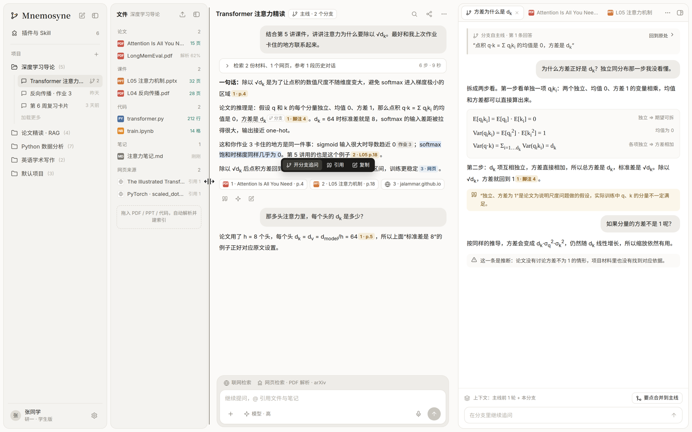
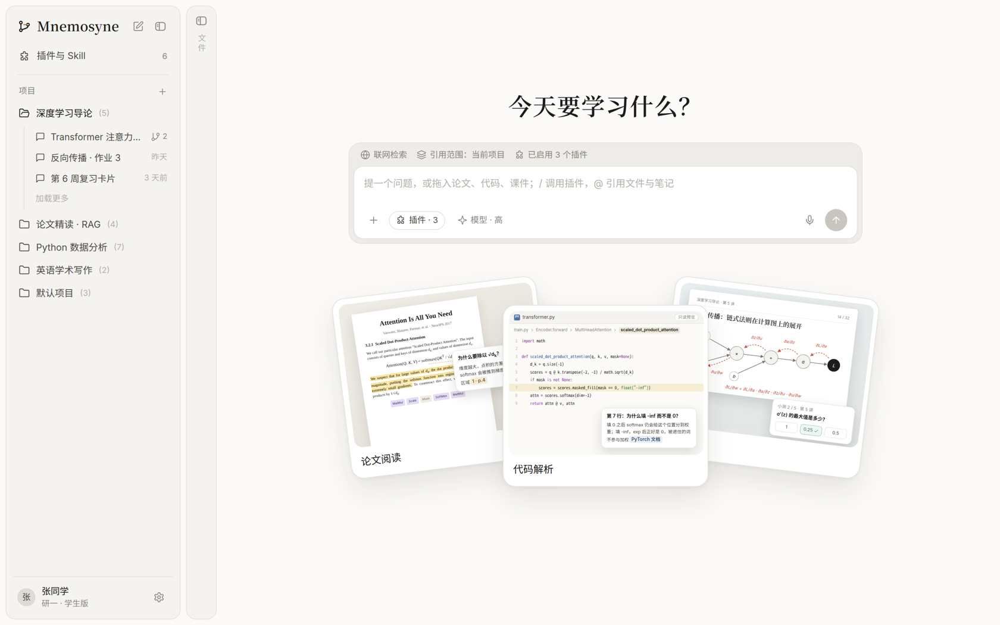
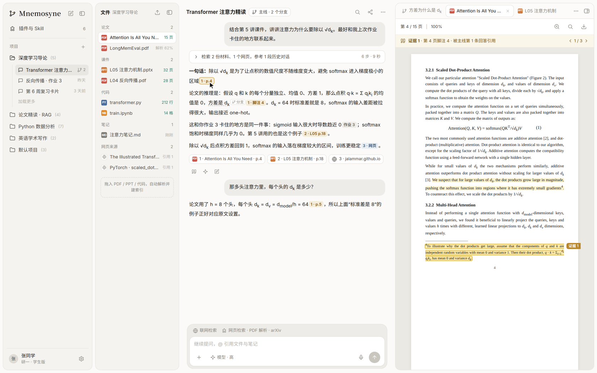
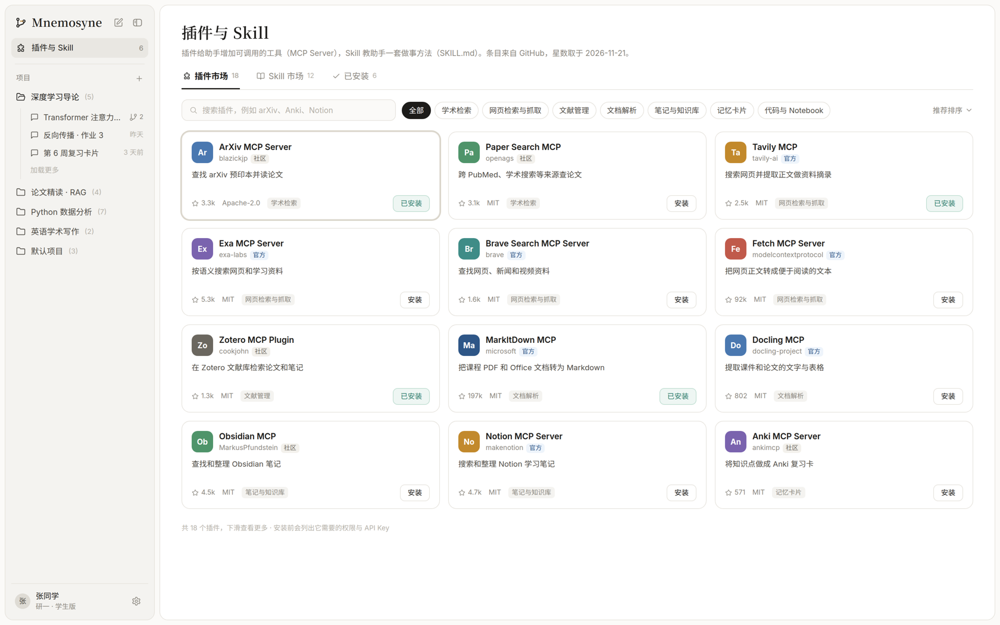
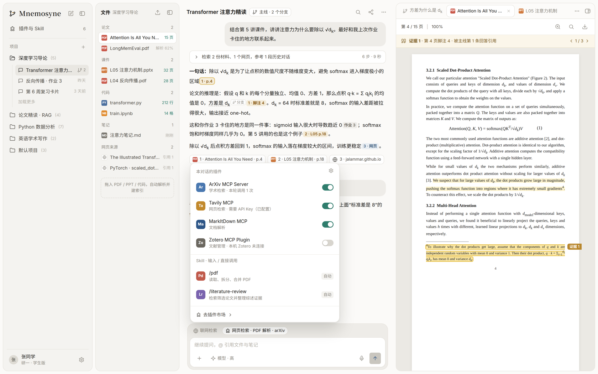

# Mnemosyne

**A learning assistant with long-term memory, evidence you can click back to, and conversations you can branch.**

Mnemosyne helps students work through papers, code and lecture slides. Answers point to the exact sentence, slide or line they rely on. Any sentence in an answer can be opened as a side branch for a follow-up question without derailing the main thread. Across sessions the assistant remembers what the student has studied and where they got stuck. Tools such as arXiv search or Zotero plug in through MCP servers, and reusable workflows are added as Skills.

This is the course project for INFO5000 (HKUST-GZ). Besides the app, the project produces a short paper that evaluates two things current memory benchmarks rarely measure: whether cited evidence actually lands on the right source, and whether information leaks between branches.

> **Status (2026-11-22): design complete, implementation not started.** Everything below describes the planned system. The screenshots are design mockups rendered from HTML, not the running app. See [Roadmap](#roadmap) for what is built and when.

[中文说明](./README.zh-CN.md) · [Developer & agent guide](./AGENTS.md) · [UX specs](./docs/ux/README.md) · [API contract](./docs/contract/README.md)

---

## What it does

| Feature | What the user sees |
|---|---|
| **Evidence tracing** | Uploaded PDFs, PPTX, code, notebooks and Markdown, plus web pages fetched during a turn, become *evidence units*. Each supported sentence in an answer carries a clickable chip; clicking it opens the right pane at the exact page, slide, line or web snapshot. Sentences without support are marked as inference. |
| **Branching conversations** | Select text in any answer → *Branch from here*. The branch opens in the right pane and only sees the path *root → anchor → branch*. Later main-thread turns and sibling branches stay out of its context. Key points can be merged back into the main thread. |
| **Long-term memory** | Four layers: the raw message tree (L1), per-conversation digests (L2), topic memories (L3) and a short learner profile (L4). Every memory item links back to the messages it came from. Memory runs in the background and is managed under *Settings → Memory*; the main UI does not emphasise it. |
| **Plugins & Skills** | A plugin market (MCP servers such as ArXiv, Fetch, Zotero, Anki, Jupyter) and a Skill market (`SKILL.md` folders such as Anthropic's `pdf`, `pptx`). Plugins can be switched on per conversation. |

## Interface (design mockups)

The workspace has four resizable, collapsible panes: projects, files, conversation, and a right pane that holds branches and read-only previews.



| | |
|---|---|
|  Home: "今天要学习什么？" with three capability cards |  Clicking an evidence chip jumps to the PDF sentence |
|  Plugin market |  Per-conversation plugin switches |

All 11 mockups are in [`docs/assets/ui/`](docs/assets/ui/). Paper excerpts in the mockups are re-typeset for illustration and are not screenshots of the original PDFs.

## Architecture


Each turn runs this pipeline:

1. **Build context**: system prompt, L4 profile, messages on the current branch path, enabled plugin tools, and Skill names with descriptions.
2. **Tool loop** (ReAct, at most 8 steps): `search_materials`, `search_web`, `fetch_url`, `recall_memory`, `open_source`, `load_skill`, plus plugin tools. Every returned snippet is registered as candidate evidence `E1…Ek`.
3. **Generate with citations**: the model may only cite `[[E#]]` from this turn's pool.
4. **Verify citations**: each citation must exist in the pool, overlap lexically with the quoted sentence, and pass a small-model support check. Unsupported citations are removed and the sentence is marked as inference.
5. **Stream and persist** over SSE: steps, evidence and text deltas stream live; citation verdicts arrive after generation; `message.end` is sent once everything is stored.
6. **Background jobs**: memory extraction and consolidation, digest and profile rewrites, indexing of new files and web snapshots.

More diagrams: [turn pipeline](docs/assets/arch/f2-turn-pipeline.png) · [memory](docs/assets/arch/f3-memory.png) · [evidence](docs/assets/arch/f4-evidence.png) · [branching](docs/assets/arch/f5-branching.png) · [plugins & Skills](docs/assets/arch/f6-plugins-skills.png) · [data model](docs/assets/arch/f7-data-model.png) · [evaluation](docs/assets/arch/f8-evaluation.png) · [UX flow](docs/assets/arch/f9-ux-flow.png)

### Planned stack

| Layer | Choice |
|---|---|
| Frontend | React 18, TypeScript, Vite, Tailwind CSS, Zustand, TanStack Query, react-resizable-panels, pdf.js, Shiki, framer-motion; MSW mocks the backend during frontend development |
| Backend | FastAPI with SSE, SQLite (WAL) with FTS5 and sqlite-vec, PyMuPDF, python-pptx (+ LibreOffice for previews), trafilatura, the official `mcp` Python SDK |
| Retrieval | BM25 and vector top-50 each, fused with RRF (k = 60), top-8 into the evidence pool |
| Models | Any OpenAI-compatible endpoint; the chat model and the small model (memory extraction, citation checks) are configured separately |

### Planned layout

```text
web/        React frontend (four-pane workspace, markets, previews)
server/     FastAPI backend (agent loop, memory, evidence, branches, plugins, jobs)
  scripts/  ingestion, registry build, LongMemEval prep, BranchMem generation, eval, judging, metrics
docs/
  contract/ REST, SSE, data model, locators, plugin manifest — single source of truth
  ux/       one spec per window, module and button, written for coding agents
  prompts/  ready-to-use task prompts for each milestone
  assets/   mockups and architecture diagrams
```

## Evaluation

| | |
|---|---|
| **Data** | LongMemEval_S (cleaned, 500 questions, ~115k-token histories with session- and turn-level evidence labels); a stratified dev split of 120 questions for tuning; **BranchMem**, our 120–150 item set built from LongMemEval with the correct evidence on the ancestor path and conflicting values in sibling branches |
| **Systems** | B1 full context · B2 naive RAG · M Mnemosyne · A1–A4 ablations (no source look-up, no evidence anchoring, no branch scoping, no L4 profile) |
| **Metrics** | QA accuracy (official GPT-4o judge), evidence Recall@k (session/turn), cited-turn hit rate plus a manual check of 100 answer–quote pairs, abstention accuracy, BranchMem branch accuracy and cross-branch leak rate, tokens and latency per question |

Hypotheses: evidence anchoring mainly helps knowledge-update and abstention questions (H1); cited-turn hit rate beats naive RAG (H2); branch scoping brings leakage close to zero without hurting main-thread accuracy (H3). Results will be reported whether or not they support these. We do not aim for a leaderboard total; vendor-reported scores are cited as background only.

## Roadmap

Frontend first, then backend. Start date 2026-11-23 is provisional until the course deadline is confirmed.

| Week | Work | Status |
|---|---|---|
| W1 | Contract fixtures, design tokens, four-pane shell, home page and cards | planned |
| W2 | Conversation stream, evidence chips, previews, branches, markets (all on MSW mocks) | planned |
| W3 | Database, file parsing, hybrid retrieval | planned |
| W4 | Agent loop, SSE, citation verification; LongMemEval and BranchMem data prep | planned |
| W5 | Long-term memory, branch isolation, plugin runtime (ArXiv and Fetch fully supported first) | planned |
| W6–7 | Tuning on dev-120, full runs and ablations | planned |
| W8 | Paper and demo video | planned |

Progress is tracked in [`docs/PROGRESS.md`](docs/PROGRESS.md).

## Known limits of v1

- Plugin permissions are declared by each plugin and shown at install time. v1 has no sandbox, so they are not enforced.
- Deleting a memory removes the derived items and blocks re-extraction; the original messages remain until the conversation itself is deleted.
- Skill scripts are not executed in v1; only `SKILL.md` text is loaded.
- Single user, local machine, no accounts or mobile layout.

## For contributors and coding agents

Read [`AGENTS.md`](AGENTS.md) first. It points to the development rules, the API contract, the per-element UX specs and the progress board. All code in this repository is written from scratch for this project.

## References

- Wu et al. *LongMemEval: Benchmarking Chat Assistants on Long-Term Interactive Memory.* ICLR 2025. <https://github.com/xiaowu0162/LongMemEval>
- Maharana et al. *Evaluating Very Long-Term Conversational Memory of LLM Agents.* ACL 2024.
- Packer et al. *MemGPT: Towards LLMs as Operating Systems.* 2023.
- Chhikara et al. *Mem0: Building Production-Ready AI Agents with Scalable Long-Term Memory.* 2025.
- Rasmussen et al. *Zep: A Temporal Knowledge Graph Architecture for Agent Memory.* 2025.
- Conversation Tree Architecture, arXiv:2603.21278; Context Branching, arXiv:2512.13914.
- Model Context Protocol: <https://modelcontextprotocol.io> · Agent Skills: <https://github.com/anthropics/skills>

## License

Not chosen yet.
