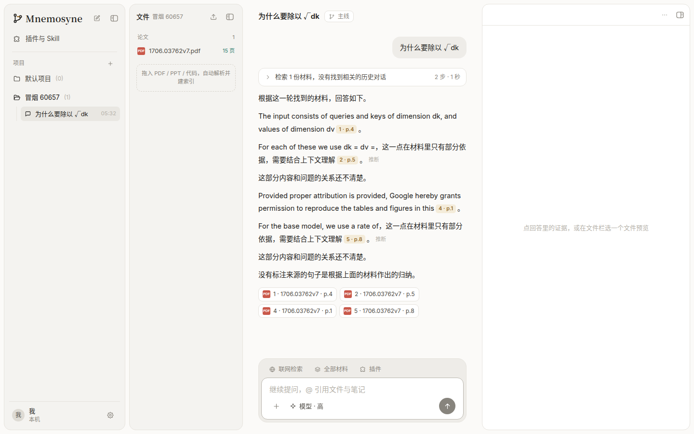
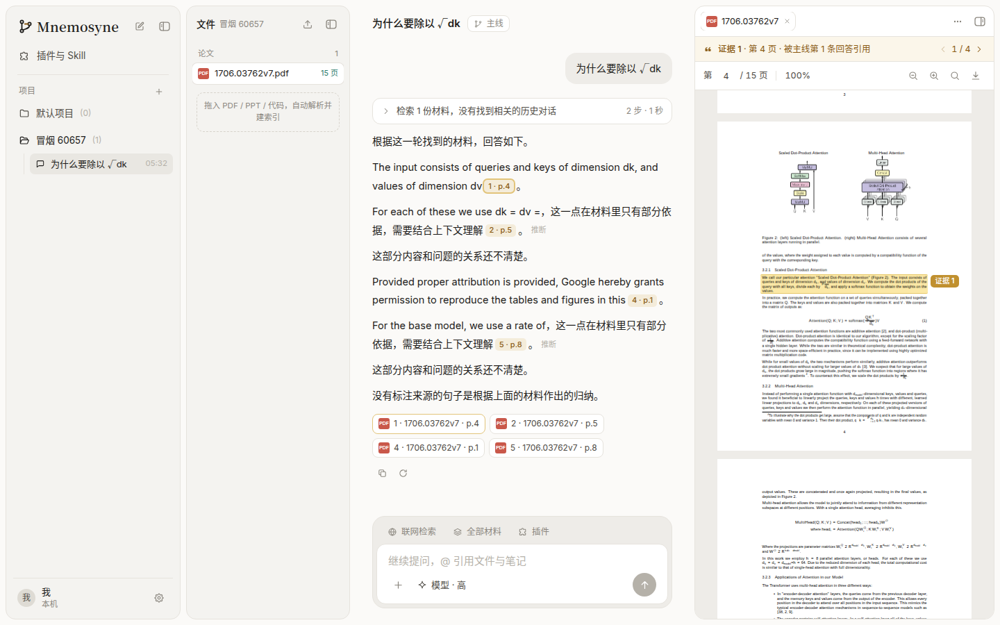
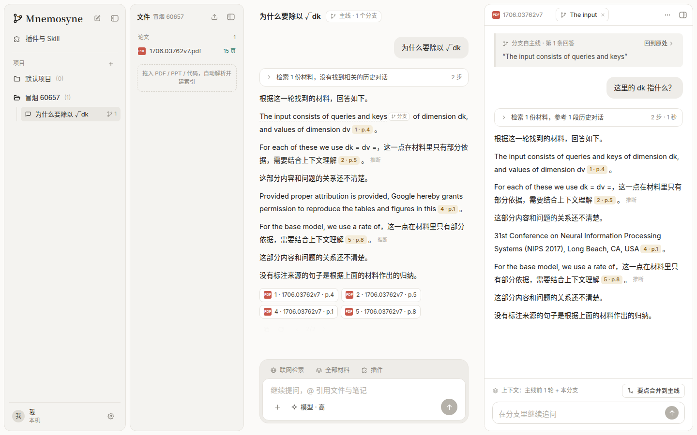
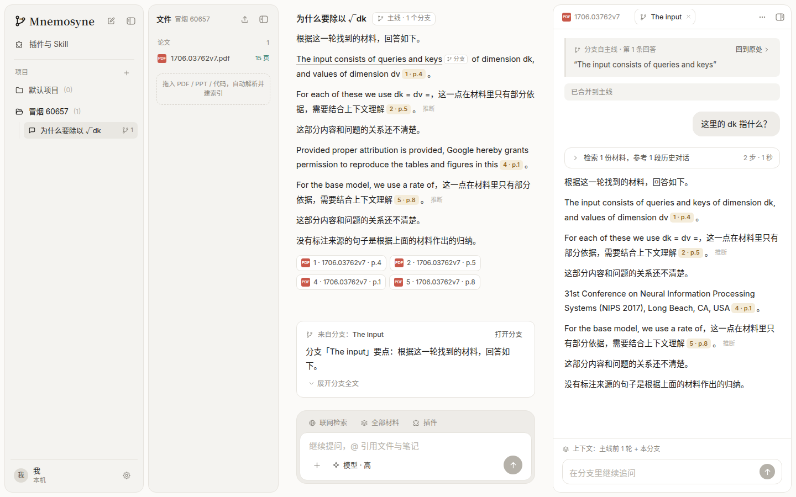
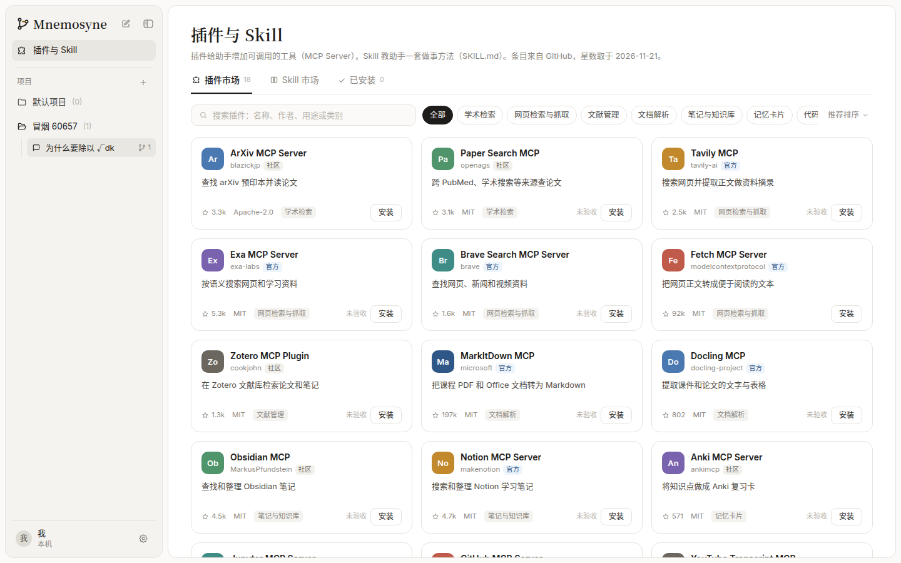
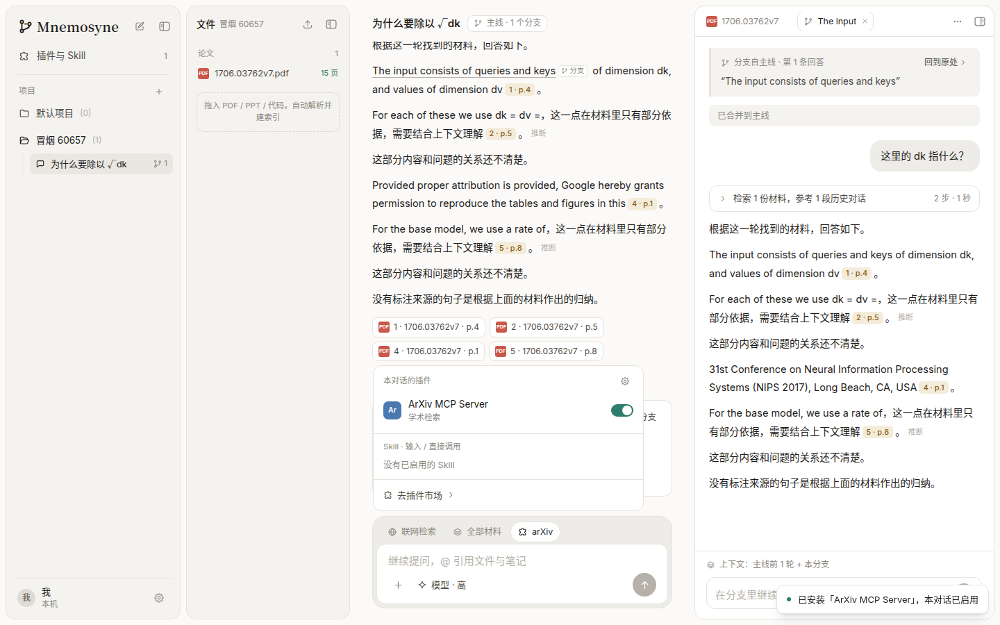

# Mnemosyne（中文说明）

**一个带长程记忆、证据可点回原文、对话可以分支的学习助手。**

Mnemosyne 帮学生读论文、看代码、学课件。回答里有依据的句子都带证据胶囊，点开就定位到原文的那一页、那一张幻灯片或那一行代码；找不到依据的句子标为推断。回答中任意一句话都能开分支追问，主线不被打断。跨会话记得学生学过什么、在哪里卡过。arXiv、Zotero 等工具通过 MCP 插件接入，常用做法以 Skill 形式加载。

这是 INFO5000（港科广）的课程项目，除了应用本身，还要写一篇小论文，评测两件现有记忆基准很少测的事：回答引用的证据有没有落在正确来源上，以及分支之间会不会串信息。

> **状态（2026-11-23）：前端与后端都已实现，能在本机连起来运行；评测还没有真跑。**
> Mnemosyne 不内置付费模型，采用**用户自带密钥（BYOK）**：在“设置 → 模型”里填自己的 API 地址、密钥和对话模型之前，后端用**确定性假模型**和假嵌入器，不发起任何付费调用，输入框下方显示“演示模式”提示；这时的回答是把检索到的原文句子套进模板生成的文字，不是真实模型的输出。联网搜索服务和 LongMemEval 数据集还要配置（见[已知限制](#已知限制)）。代码只在本机运行，没有部署。

[English](./README.md) · [开发与 Agent 指南](./AGENTS.md) · [UX 规格](./docs/ux/README.md) · [接口契约](./docs/contract/README.md) · [进度看板](./docs/PROGRESS.md)

## 功能

| 功能 | 用户看到什么 |
|---|---|
| 证据追踪 | 上传的 PDF、PPTX、代码、Notebook、Markdown，以及本轮抓取的网页，统一成证据单元。有依据的句子带胶囊，点开在右栏定位原文（琥珀色＝材料，蓝色＝网页，灰色＝历史对话）。 |
| 分支对话 | 在回答里选中文字 → 开分支追问。分支在右栏打开，上下文只取“根 → 锚点 → 分支”这条路径，可以把要点合并回主线。 |
| 长程记忆 | 四层：原始消息树（L1）、对话摘要（L2）、主题记忆（L3）、画像摘要（L4）。每条记忆都能回到产生它的原始消息。界面上不单独突出记忆，管理入口在“设置 → 记忆”。 |
| 插件与 Skill | 插件市场（ArXiv、Fetch、Zotero、Anki、Jupyter 等 MCP Server）与 Skill 市场（Anthropic 的 pdf、pptx 等 SKILL.md 目录），插件可按对话开关。 |

## 界面

### 真实运行截图（假模型）

下面是端到端冒烟测试（`web/tests/e2e-real/`）连真实 FastAPI 后端时截的图，1440×900。**后端跑的是确定性假模型**，回答文字是用检索到的 PDF 句子拼成的模板；步骤行、证据胶囊、PDF 定位高亮、分支与市场流程都是真实运行结果。论文是 arXiv:1706.03762（测试时下载，不随仓库分发）。

| | |
|---|---|
|  回答顶部的步骤行与句末证据胶囊 |  点胶囊 1，右栏打开 PDF 第 4 页并高亮原句 |
|  选中一句开分支，在右栏追问 |  要点合并回主线，分支变为只读 |
|  插件市场（条目均为 GitHub 真实项目） |  安装插件后，输入框插件区列出本对话已启用的插件 |

最后一张里安装的插件是挂在 ArXiv 条目下的本地假 MCP 服务，测试不联网。

### 设计稿

最初的设计是 11 张 HTML 渲染的概念图，见 [`docs/assets/ui/`](docs/assets/ui/)（例如[四栏工作区与分支](docs/assets/ui/05-workspace-branch.png)），架构图见 [`docs/assets/arch/`](docs/assets/arch/)。实现与概念图不一致的地方记在 [`docs/PROGRESS.md`](docs/PROGRESS.md)。

## 技术方案

- 前端：React 18 + TypeScript + Vite + Tailwind + Zustand + TanStack Query + pdf.js + Shiki + react-markdown/KaTeX；分栏是自写的指针拖拽布局。前端测试用 MSW 模拟后端。
- 后端：Python 3.11，FastAPI + SSE，SQLite（FTS5 + sqlite-vec），PyMuPDF、python-pptx、trafilatura，官方 mcp Python SDK。
- 检索：BM25 与向量各取前 50，RRF 融合后取前 8 条进入证据池。
- 每轮流程：构造上下文 → 工具循环（最多 8 步）→ 只能引用本轮证据的生成 → 三关引用校验 → SSE 推送与写库 → 回合后异步更新记忆与索引。
- 模型：任何 OpenAI 兼容接口，对话模型与小模型（记忆抽取、引用校验）分开配置；默认是确定性假模型与本地哈希假嵌入，不联网。

## 本地运行

在 Linux、Python 3.11（用 [uv](https://docs.astral.sh/uv/) 管理）、Node.js 24 上测试过。除非自己设了真实模型的环境变量，下面的命令都不会产生费用。

后端：

```bash
cd server
uv sync                                    # 建 .venv 并安装依赖
uv run python scripts/fetch_test_data.py   # 可选：下载测试用论文 arXiv 1706.03762v7
uv run uvicorn app.main:app --port 8100    # 默认假模型 + 假嵌入；数据在 server/data/
```

前端：

```bash
cd web
npm ci
npm run dev                                   # MSW 模式：/api 全部由 src/mocks/ 模拟，不需要后端
MN_BACKEND=http://localhost:8100 npm run dev  # 连真实后端：关闭 MSW，/api 代理到后端
```

打开 <http://localhost:5170>。`bash web/scripts/fetch-samples.sh` 下载 MSW 预览用的示例 PDF。

测试：

```bash
cd server && uv run pytest -q              # 后端单元、接口与契约测试（假模型，不联网）
cd web && npm run check                    # 类型检查、lint、prettier、fixture 结构校验
cd web && npm test                         # Vitest 单元测试
cd web && npx playwright test              # MSW 上的端到端测试（截图在 web/tests/screenshots/）
cd web && npx playwright test -c tests/e2e-real/playwright.real.config.ts   # 连真实后端的冒烟测试（截图在 web/tests/screenshots-real/）
```

Playwright 用本机已有的 Chromium，用 `MN_CHROMIUM` 指向它的可执行文件；`MN_PORT`、`MN_API_PORT` 改端口。

**用自己的模型（BYOK）**：打开“设置 → 模型”，选服务商预设（OpenAI、DeepSeek、OpenRouter）或“自定义（OpenAI 兼容）”，填入自己的 API Key，确认模型名，点“测试连接”，再保存。之后发出的消息就用你的模型，费用记在你自己的账户上。密钥只存在本机后端（`server/data/settings.json`，权限 0600），任何接口都不回传明文，只显示“已设置”和末 4 位。预设里的模型名是 2026-11-23 对照各家官方文档挑的建议值（U130）。环境变量仍然可用：`MN_LLM_API_BASE`、`MN_LLM_MODEL`、`MN_LLM_SMALL_MODEL`、`MN_LLM_API_KEY`；`MN_LLM_BACKEND=fake` 强制假模型（测试用），`openai` 强制真实模型，不设则配置好就自动用真实模型。真实嵌入用 `MN_EMBED_BACKEND=openai` 和 `MN_EMBED_API_BASE`、`MN_EMBED_MODEL`、`MN_EMBED_API_KEY`（只读环境变量）、`MN_EMBED_DIM`，然后运行 `uv run python scripts/ingest.py --project <id> --reindex`。全部变量见 [`server/README.md`](server/README.md)。这套代码还没有接真实模型跑过：所有测试用的是模拟接口和假模型。

插件：插件是作为子进程启动的 MCP Server。市场里只有 4 个条目有适配清单（ArXiv、Fetch、MarkItDown 用 `uvx`，Tavily 用 `npx`），其余显示“暂未适配”、不能安装。所以安装插件需要 `PATH` 里有 `uvx`（随 uv 安装）或 `npx`（随 Node.js 安装），首次下载需要联网。安装流程与工具调用只用本地假 MCP 服务测过，从 PyPI 安装真实 ArXiv、Fetch 服务的端到端流程还没验证。不设 `MN_WEB_SEARCH_PROVIDER` 时回合里没有联网搜索。

## 评测（计划）

LongMemEval_S（cleaned，500 题）＋ 自建 BranchMem（120–150 题）。对比全量上下文、朴素 RAG、完整系统和 4 个消融，指标包括问答准确率、证据召回、引用轮次命中率（另人工抽查 100 对“回答句—原文”）、拒答正确率、跨分支泄漏率和每题成本。

评测脚本已写完，只在手写的 16 题合成数据上用假模型跑通，真实数据集还没下载。

## 进度

| 阶段 | 状态 |
|---|---|
| 前端（四栏外壳、主页、对话流、证据胶囊、预览、分支、市场与设置） | 完成 |
| 后端（数据库、解析与混合检索、Agent 主回路与引用校验、长程记忆、分支可见性、插件运行时、Skill） | 完成（假模型）；真实 ArXiv/Fetch 安装未验证 |
| 前后端集成与真实后端冒烟 | 完成（假模型） |
| BYOK：用户自带密钥、服务商预设、测试连接、演示模式提示 | 完成（用模拟接口测试，未用真实密钥） |
| 评测：dev-120 调参、全量与消融 | 按 BYOK 设计：项目不内置模型、不设预算；评测脚本已就绪，由使用者用自己的 Key 运行并下载 LongMemEval 数据 |
| 论文与演示视频 | 完成 |

## 已知限制

仍待决定的事项（编号与细节见 [`docs/PROGRESS.md`](docs/PROGRESS.md)）：

- **模型（BYOK）**：由用户自带密钥，项目不内置模型、也不设预算。还没有用真实密钥跑过，目前所有效果都是假模型跑的。评测读同一份设置，默认只跑 10 题（`--max-items`），先报成本再决定是否扩量。设置里的嵌入模型目前只保存，检索仍用本地 BM25 + 假向量，要不要换成真实嵌入并重建索引待定（U131）。
- **联网搜索服务（U73）**：默认不提供 `search_web`；Tavily 适配代码已写，没有用真实 Key 测过。
- **插件简称（U93）**：3 个取自 UX 规格，其余 15 个是开发中拟定的，待确认。
- **判分提示的许可（U105）**：LongMemEval 判分提示逐字移植自官方 MIT 许可的 `evaluate_qa.py`（保留版权声明），与“代码全新写”的规则字面冲突，待追认。
- **PyMuPDF 是 AGPL-3.0（U45），仓库 License 未定（U10）**：后端以网络服务形式使用 PyMuPDF 会带来 AGPL 的源码提供义务；可换 pypdfium2 或 pdfplumber，但要重写 PDF 解析。
- **“试一试”的示例材料（U8）**：主页卡片还不会上传示例文件。
- 评测记账：每题一位新用户、独立数据库；记忆抽取的 token 不计入，回放成本会被低估，见 [`server/scripts/README-eval.md`](server/scripts/README-eval.md#已知限制真跑前必读)。

第一版有意不做的：

- 插件权限由插件自行声明并在安装时展示，第一版没有沙箱，无法强制执行。
- 删除记忆只删派生条目并屏蔽重新抽取，原始消息在删除对话前仍保留。
- Skill 附带脚本第一版不执行。
- 单用户、本机运行，不做账号与移动端。

## License

尚未选定。
